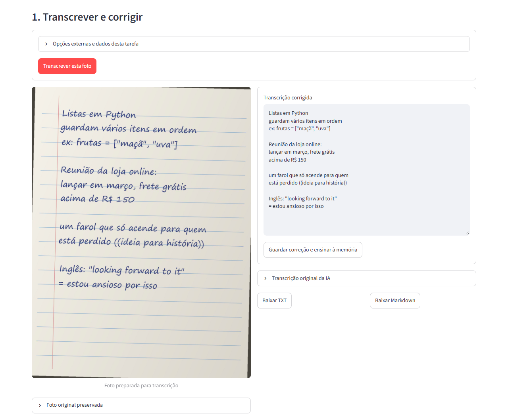
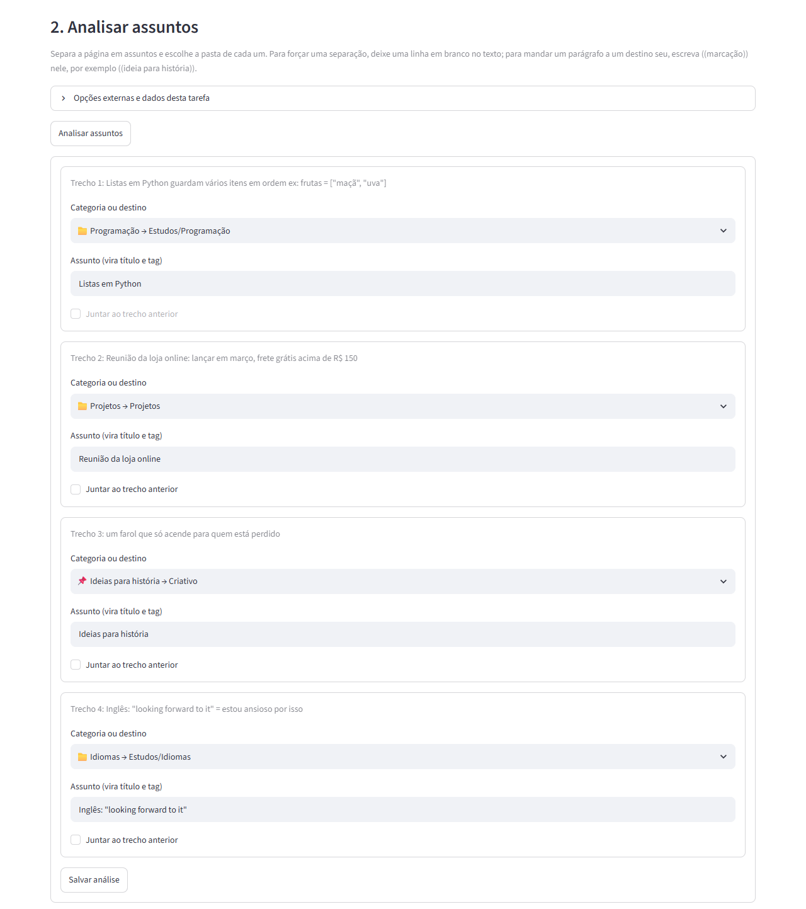
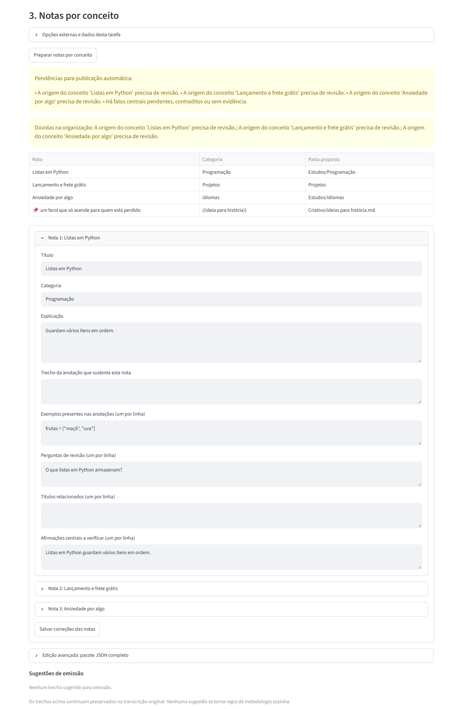
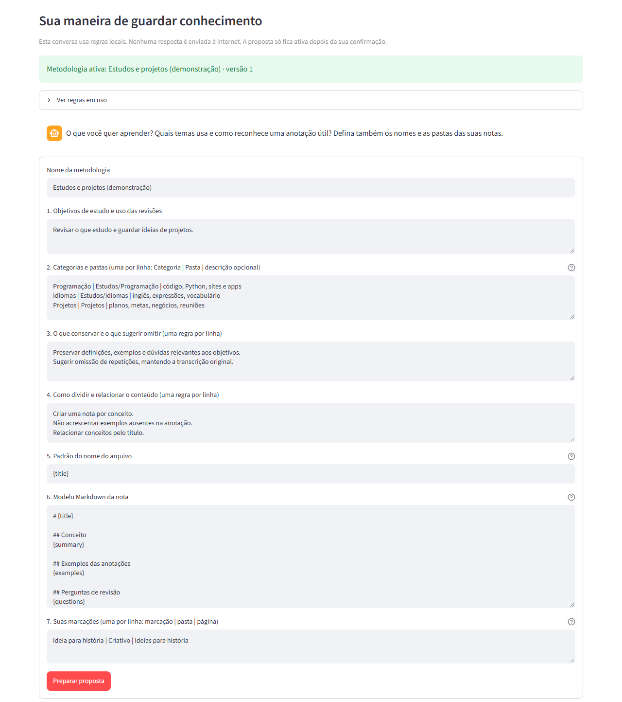
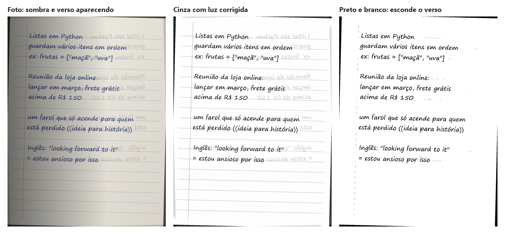
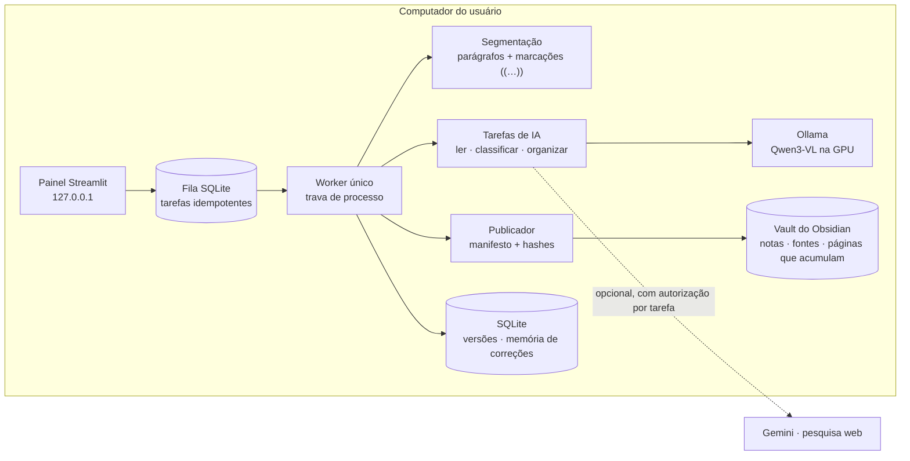

<p align="center">
  
</p>

<h1 align="center">Shiori</h1>

<p align="center">
  <strong>Da folha do caderno para o Obsidian.</strong><br>
  Fotografe suas anotações à mão: o Shiori lê a sua letra, separa os assuntos da página e organiza cada um
  no lugar certo do seu vault. Tudo <strong>no seu computador</strong>, com IA local.
</p>

<p align="center">
  
  
  
  
  
  
  
</p>

> 🔒 **Este é o repositório vitrine.** O código-fonte completo fica em um repositório privado.
> Recrutador(a)? [Veja como pedir acesso](#-acesso-ao-código).

<sub>*Shiori* (栞) é "marcador de página" em japonês.</sub>



---

## O problema

Eu estudo e planejo no caderno. Uma única folha costuma misturar:
- um conceito de Python;
- a pauta de uma reunião;
- uma frase em inglês;
- uma ideia solta para uma história.

Passar isso para o Obsidian à mão leva tempo, e as ideias ficam esquecidas no papel.

As saídas prontas também não serviam:
- **OCR na nuvem** expõe anotações pessoais e cobra por uso;
- **um modelo local pequeno** lê bem quando funciona, mas trava em loops, inventa categorias e mistura assuntos.

O Shiori resolve isso com IA local e revisão humana em cada etapa, sem publicar nada sem aprovação.

## O que ele faz

| | |
|---|---|
| 📷 **Lê a sua letra** | Foto do caderno → texto, com o Qwen3-VL (2B) rodando na GPU pelo Ollama: ~6 s por página. Corrija no painel, e a correção ensina as próximas leituras. |
| 🧩 **Separa os assuntos** | Cada assunto da folha vira a sua nota, na pasta da sua categoria (ex.: Programação → `Estudos/Programação`). O assunto vira título e tag. |
| 📌 **Marcações suas** | Escreva `((ideia para história))` num parágrafo: ele vai literal, sem IA, para o fim da página "Ideias para história". |
| ✍️ **Você revisa tudo** | Texto, separação de assuntos e notas são editáveis antes de publicar. O painel mostra o **próximo passo** e se atualiza sozinho. |
| 🧠 **Aprende sem vazar** | A memória guarda só as suas correções curtas (grafia, categoria), nunca o conteúdo de outra página. |
| ↩️ **Desfazer seguro** | Publicar nunca sobrescreve um arquivo seu. Desfazer remove só o que o Shiori criou e ainda está intacto. |
| 🖼️ **Realce de imagem** | Corrige sombra e luz irregular (cinza) ou esconde o verso aparecendo (preto e branco), com prévia. |
| 📄 **Também texto** | Já tem a anotação digitada? Envie `.txt`/`.md` e ela segue o mesmo fluxo. |
| 🔐 **Local por padrão** | Gemini e pesquisa web são opcionais, com autorização por tarefa e prévia dos dados enviados. |

## Telas

| Separar os assuntos da página | Notas por assunto e destino de cada trecho |
|---|---|
|  |  |

| Sua metodologia: categorias, pastas e marcações |
|---|
|  |

**Realce de imagem** (função real do app sobre uma página com sombra e verso aparecendo):



<sub>Dados fictícios: página de demonstração escrita em fonte manuscrita, metodologia e vault de exemplo. Leitura feita com o modelo 2B; análise de assuntos e notas com o 4B.</sub>

## Arquitetura



- **Um processo, um worker:** cada clique vira uma tarefa persistente. Repetir o clique não duplica, e um resultado antigo nunca sobrescreve uma edição mais nova.
- **O modelo classifica, o código decide:** a página é dividida em parágrafos de forma determinística. A IA só diz assunto e categoria de cada bloco, e as regras de junção e validação ficam no código.
- **Publicação transacional:** o manifesto é gravado antes de qualquer arquivo e permite retomar ou desfazer com segurança.

Mais detalhes em [**docs/decisoes-tecnicas.md**](docs/decisoes-tecnicas.md).

## Destaques técnicos

- **Leitura robusta medida em fotos reais.**
  - Pedindo JSON, o modelo de 2B entrava em loop e concluía **9 de 31** páginas.
  - Com texto puro e penalidade de repetição, **28 de 31**; as 3 restantes, depois do realce de imagem.
  - Ver [trecho](trechos/leitura_local.py).
- **Separação de assuntos.**
  - A primeira regra dividia páginas de um tema só em 4–8 notas. A atual junta vizinhos da mesma categoria: fronteiras certas **9/30 → 22/30** no gabarito.
  - Categorias certas: 24/35 com o modelo 2B e **29/35** com o 4B, usando descrições ([trecho](trechos/marcacoes_e_assuntos.py)).
- **Bug real, teste real.**
  - No uso do painel, uma nota saiu com título e resumo **de outra página**: a memória enviava notas inteiras como exemplo, e o modelo copiava.
  - Agora a memória guarda só correções curtas ([trecho](trechos/memoria_de_correcoes.py)), com teste de regressão ([teste](trechos/teste_exemplo.py)).
- **Escrever em arquivos do usuário sem medo.**
  - Notas novas são criadas por hardlink exclusivo: nunca sobrescrevem.
  - Páginas que acumulam recebem blocos delimitados por troca atômica, conferindo antes se o usuário editou a página no meio ([trecho](trechos/pagina_acumulativa.py)).
  - Desfazer confere hashes e recusa a operação inteira se algo foi editado depois.
- **Privacidade e segurança.**
  - Nada sai do computador sem autorização por tarefa, e o consentimento fica preso aos dados exatos mostrados.
  - Chaves só em memória.
  - O verificador web fixa o DNS e bloqueia endereços internos (proteção contra SSRF).
  - Caminhos do vault são validados contra `..`, pastas ocultas, symlinks e junctions.

## Qualidade

- **160 testes** com pytest, **sem nenhuma chamada real de rede**: o HTTP do Ollama, do Gemini e da pesquisa é simulado com `httpx.MockTransport`.
- O painel é testado com `streamlit.testing`: upload de texto, análise de assuntos, realce, próximo passo e abas que não pulam.
- Desenvolvido em fatias pequenas: teste que falha → implementação → regressão completa, com um commit por funcionalidade.
- Validação no ambiente real:
  - 31 fotos de cadernos com gabarito;
  - fluxo completo no painel, com publicar e desfazer num vault de teste;
  - publicação num vault do Obsidian sincronizado pelo OneDrive.

## Stack

**Aplicação:** Python 3.14 · Streamlit · Pydantic · SQLite · httpx · Pillow · NumPy
**IA local:** Ollama · Qwen3-VL 2B (leitura) e 4B (classificação, opcional)
**Opcionais:** Gemini API · Tavily (pesquisa para verificar afirmações)
**Destino:** Obsidian (Markdown, frontmatter com categorias e tags)
**Testes:** pytest · httpx.MockTransport · streamlit.testing

## Em números

| | |
|---|---|
| Python (aplicação) | ~3.200 linhas |
| Python (testes) | ~2.000 linhas, 160 testes |
| Fotos reais medidas | 31 páginas de caderno |
| Leitura concluída | 9/31 → 28/31 |

## Estrutura do código (repositório privado)

```
shiori-codigo/
├── obsidian_agent/
│   ├── app.py            # painel: foto/texto → análise → notas → publicação
│   ├── pipeline.py       # fila, worker único, etapas e autorização
│   ├── providers.py      # tarefas de IA (Ollama local; Gemini opcional)
│   ├── segmentation.py   # parágrafos, marcações ((…)) e junção de assuntos
│   ├── publisher.py      # vault: manifesto, hardlink, páginas que acumulam, desfazer
│   ├── storage.py        # SQLite: capturas, versões, fila, memória de correções
│   ├── imaging.py        # realce de imagem (cinza / preto e branco)
│   ├── web.py            # verificação de afirmações com proteção contra SSRF
│   └── models.py         # contratos Pydantic (metodologia, análise, notas)
├── tests/                # 160 testes
├── INSTALAR.cmd / INICIAR.cmd
└── README.md
```

Nesta vitrine estão só [**trechos curtos**](trechos/) para mostrar o estilo do código. O núcleo (painel, fila, publicação e integrações) fica no repositório privado.

## 🔑 Acesso ao código

O código completo (aplicação, testes e todo o histórico de commits) está no repositório privado
**`aresd-dev/shiori-codigo`**.

**Recrutador(a) ou empresa?** Envie um e-mail para
**[aresd.dev@gmail.com](mailto:aresd.dev@gmail.com?subject=Acesso%20ao%20c%C3%B3digo%20do%20Shiori)** com:

1. seu nome e a empresa/vaga;
2. o seu **usuário do GitHub**.

Assim que eu receber, adiciono você ao repositório privado.

---

### In English

**Shiori** turns photos of handwritten notebook pages into organized Obsidian notes, entirely on your own computer with a local vision model (Qwen3-VL via Ollama). Highlights:
- **Robust local reading:** asking a 2B model for JSON caused repetition loops (9/31 real pages read); plain-text output with a repetition penalty reads 28/31.
- **Subject separation:** the page is split into paragraphs deterministically and the model only classifies each block. Neighbor-merging rules live in code: topic boundaries went from 9/30 to 22/30 on a hand-labeled set.
- **Your own markers:** `((idea for a story))` sends a paragraph, verbatim, to an accumulating page.
- **Leak-free memory** of user corrections: a real bug where one page's note was copied into another is now a regression test.
- **Safe publishing:** manifest-first writes, exclusive hardlinks that never overwrite, delimited blocks for accumulating pages, hash-checked undo.
- **Privacy:** external AI and web search are opt-in per task, with a preview of the exact data sent.
- 160 tests with mocked HTTP and Streamlit UI tests.

The source code is private: **email [aresd.dev@gmail.com](mailto:aresd.dev@gmail.com?subject=Shiori%20source%20code%20access)
with your GitHub username to request access.**

<sub>© 2026 aresd-dev. Todos os direitos reservados: imagens e trechos publicados apenas para avaliação do projeto.</sub>
